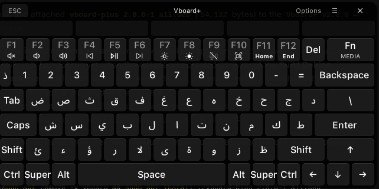
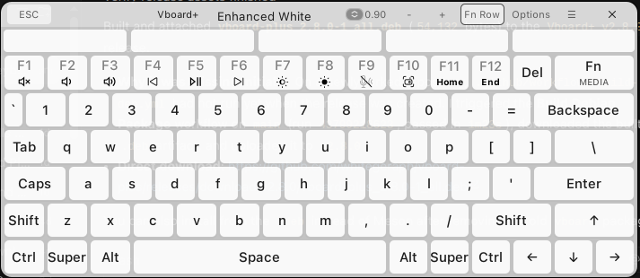
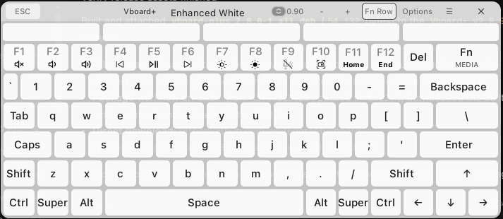

#   <br> Vboard+
> **Fork Notice:** **Vboard+** is an enhanced fork of [`archisman-panigrahi/vboard`](https://github.com/archisman-panigrahi/vboard) (originally created by [`mdev588/vboard`](https://github.com/mdev588/vboard)).

*A resizable virtual keyboard for GNU/Linux with Wayland support on KDE Plasma, GNOME support via Xwayland, a toggleable `F1`–`F12` Function Row, Arabic layout, automatic system layout sync, and `Ctrl`, `Alt`, `Tab`, `Super` keys.*

It supports many themes, as you can see below:







## Overview
**Vboard+** (`vboard-plus`) is a lightweight, customizable virtual keyboard designed for Linux desktop systems. Forked from [`archisman-panigrahi/vboard`](https://github.com/archisman-panigrahi/vboard), it runs as a Wayland-compatible on-screen keyboard on KDE Plasma and works on GNOME via Xwayland fallback, adding:
- A fully scalable **resizable window** down to compact mini sizes
- A toggleable **`F1`–`F12` + `Del` + `Fn` Function Row** with persistent `Fn` lock and outlined symbolic media icons
- An **Arabic layout** (including Shift-accessible diacritics and ligatures)
- **Automatic system keyboard layout synchronization**

## Features
- **Customizable appearance**: Change background color, theme style (`classic`, `onboard`, `enhanced`), and opacity
- **Responsive resizable window**: Dynamically scales keys, fonts, headerbar controls, suggestion bar, and gesture-typing hitboxes across window sizes (down to compact mini sizes), persisting validated dimensions
- **Top Function Row (`F1`–`F12`, `Del`, `Fn`)**: Toggleable from the headerbar (`Fn` button), Settings dialog, or tray menu, with persistent `Fn` lock (`LOCK` / `MEDIA` modes), outlined symbolic icons for `Mute`, `Vol-`, `Vol+`, `Prev`, `Play`, `Next`, `Bri-`, `Bri+`, `MicMute`, and `PrtSc`, text labels for `Home` and `End`, tap-only safety on screenshot/media keys, and a `uinput` stuck-key watchdog
- **Multiple layouts & Arabic support**: Includes English (US), German, French (AZERTY), Russian, Swedish, and Arabic layouts (with Shift-accessible Arabic diacritics and ligatures)
- **Automatic system layout sync**: **Follow System Layout** (enabled by default; toggleable in Settings and the tray menu) automatically switches Vboard+ when your GNOME input source (`org.gnome.desktop.input-sources`) or `Gdk.Keymap` changes
- **Persistent settings**: Configuration is saved between sessions in `~/.config/vboard-plus/settings.conf`
- **Modifier key support**: Provides `Shift`, `Ctrl`, `Alt`, `Tab`, `Super` (Meta/Win), and `Fn` keys
- **Desktop compatibility**: Native Wayland-friendly behavior on KDE Plasma, with GNOME support via Xwayland fallback
- **Hold for repetitive clicks**: Keep holding the mouse button to trigger repeated clicks on repeatable keys
- **Word suggestions**: Offers completions from an installed Hunspell dictionary while you type with Vboard+
- **Gesture typing**: Swipe across letter keys and Vboard+ will decode the path into a word
- **Compact interface**: Headerbar with minimal controls (`☰`, `Fn`, `Esc`, `Options`, opacity, and color dropdown) to save screen space
- **Tray icon support**: Keeps Vboard+ running in the background and quickly reopens or configures it via StatusNotifier/AppIndicator
- **uinput input backend**: Injects keys through Linux `uinput`

Implementation notes for gesture typing are documented in [GESTURE_TYPING.md](./GESTURE_TYPING.md).

## Installation

### Ubuntu/Debian: install from this fork

1. Install dependencies (if not already installed):
```bash
sudo apt install python3-gi python3-gi-cairo gir1.2-gtk-3.0 python3-uinput gir1.2-ayatanaappindicator3-0.1 meson ninja-build --no-install-recommends
```
Optional for word suggestions:
```bash
sudo apt install hunspell-en-us
```

2. Clone this fork and prepare `uinput`:
```bash
git clone https://github.com/whitegeraph/vboard-plus.git
cd vboard-plus
sudo bash scripts/setup-uinput.sh
```

3. Build and install with Meson (if you previously installed upstream `vboard` via `apt`, remove it first with `sudo apt remove vboard`):
```bash
meson setup builddir --prefix=/usr/local
meson compile -C builddir
sudo meson install -C builddir
```

### Upstream Releases & PPA
Upstream `.deb` releases and the Ubuntu PPA for the original `vboard` project are maintained at [`archisman-panigrahi/vboard`](https://github.com/archisman-panigrahi/vboard) (`ppa:apandada1/vboard`).

### Manual installation on other distros

For Debian/Ubuntu, Fedora, Arch, and other distributions, install the dependencies manually and then build with Meson.

### 1. Install dependencies

**For Debian/Ubuntu-based distributions:**
```bash
sudo apt install python3-gi python3-gi-cairo gir1.2-gtk-3.0 python3-uinput gir1.2-ayatanaappindicator3-0.1 meson ninja-build --no-install-recommends
```
Optional for word suggestions:
```bash
sudo apt install hunspell-en-us
```

**For Fedora-based distributions:**
```bash
sudo dnf install python3-gobject python3-cairo gtk3 python3-uinput python3-setuptools libappindicator-gtk3 meson ninja-build
```
Optional for word suggestions:
```bash
sudo dnf install hunspell-en-US
```

In Fedora KDE, you will also have to create a symlink for qdbus
```
sudo ln -sf /usr/bin/qdbus-qt6 /usr/local/bin/qdbus6
```

**For Arch-based distributions:**
```bash
sudo pacman -S python-gobject gtk3 python-uinput python-cairo libayatana-appindicator meson ninja
```
Optional for word suggestions:
```bash
sudo pacman -S hunspell-en_us
```

### 2. Clone the repository

```bash
git clone https://github.com/whitegeraph/vboard-plus.git
cd vboard-plus
```

### 3. Prepare uinput (required)

Run once with sudo before Meson install:

```bash
sudo bash scripts/setup-uinput.sh
```

For system installs, this also installs a `udev` rule (`70-vboard-plus-uinput.rules`) so your logged-in desktop user can access `/dev/uinput`. If permissions still do not apply, log out/log in or restart your computer.

### 4. Build and install with Meson

**Global install:**

```bash
meson setup builddir --prefix=/usr/local
meson compile -C builddir
sudo meson install -C builddir
```

**User-only install:**

```bash
meson setup builddir-user --prefix=$HOME/.local
meson compile -C builddir-user
meson install -C builddir-user
```

**Restart for changes to take effect.**
On KDE/Plasma, install hooks automatically create the appropriate KWin window rule (`vboard-plus`) using its Wayland application ID (`io.github.whitegeraph.vboard-plus`) instead of the window title.

### 5. Uninstall

```bash
meson compile -C builddir uninstall-local
```

For system installs:
```bash
sudo meson compile -C builddir uninstall-local
```

### KDE Plasma: enable Vboard+ as the default on-screen keyboard

After installation, open **System Settings**, search for **Virtual Keyboard**, and select **Vboard+**.

## Usage
When launched (with `vboard-plus` or `python3 -m vboard.app`), Vboard+ presents a resizable virtual keyboard with a compact interface. The keyboard includes:
- Toggleable top function row (`F1`–`F12`, `Del`, `Fn`) with persistent `Fn` lock (`LOCK` for standard `F1`–`F12`, `MEDIA` for `Mute`, `Vol-`, `Vol+`, `Prev`, `Play/Pause`, `Next`, `Bri-`, `Bri+`, `MicMute`, `PrtSc`, `Home`, and `End`)
- Standard alphanumeric, punctuation, and arrow keys across 6 built-in layouts (`en`, `de`, `fr`, `ru`, `sv`, `ar`)
- Modifier keys (`Shift`, `Ctrl`, `Alt`, `Super`, `Fn`)
- Header-bar suggestions that appear while typing words through Vboard+ when a system Hunspell dictionary is available
- Experimental swipe typing on alphabetic keys: drag across the intended letters and release to insert the best matching dictionary word

### Interface Controls
- `☰` (menu) - Toggle visibility of extra headerbar controls
- `Fn` - Show or hide the top function row (`F1`–`F12`, `Del`, `Fn`)
- **Options** - Open in-app options for typing, Function Row visibility, Keyboard Layout selection, **Follow System Layout**, about, bug reports, and quit actions
- `+` / `-` - Increase or decrease opacity
- **Background dropdown** - Change the keyboard background color or pick an Onboard / Enhanced color theme
- **Right-click a key** - Send `Shift` + that key once
- **Tray icon click** - Hide or show Vboard+
- **Tray icon right-click** - Open tray controls (including **Keyboard Layout → Follow System Layout** and manual layout overrides) when the tray backend supports a separate context menu

## Configuration
Vboard+ saves its settings to `~/.config/vboard-plus/settings.conf`. This configuration file stores:
- Background color (`bg_color`)
- Theme style (`style_variant`)
- Text prediction enabled/disabled (`text_prediction_enabled`)
- Gesture typing and visual feedback (`gesture_enabled`, `gesture_visual_feedback_enabled`)
- Start minimized (`start_minimized`)
- Function row visibility and lock state (`show_function_row`, `fn_locked`)
- Keyboard layout (`keyboard_layout`) and automatic system sync (`follow_system_layout`, defaults to `True`)
- Window dimensions and position (`width`, `height`, `pos_x`, `pos_y`)
- Opacity level (`opacity`) and text color (`text_color`)

You can manually edit this file or use the built-in interface controls to customize Vboard+.

## Customizing Keyboard Layout
Keyboard layouts are JSON files (`en.json`, `de.json`, `fr.json`, `ru.json`, `sv.json`, `ar.json`). Packaged layouts are installed to:

```bash
/usr/local/share/vboard-plus/vboard/layouts/   # or /usr/share/vboard-plus/vboard/layouts/
```

User layouts can be added or overridden in:

```bash
~/.config/vboard-plus/layouts/
```

Each layout file defines an `id`, display `label`, optional sort `order`, `rows`, optional key `labels`, and optional `shifted` output. With **Follow System Layout** enabled, GNOME input sources (`org.gnome.desktop.input-sources`) such as `us`, `eg`/`ara`, `se`, `de`, `fr`, and `ru` automatically switch Vboard+ to the matching layout (with a `Gdk.Keymap` fallback on non-GNOME sessions).

To customize a packaged layout, copy its JSON file into `~/.config/vboard-plus/layouts/`, edit it, and restart Vboard+.

## Troubleshooting

### Input does not work

If Vboard+ opens but pressing keys does not type anything, the `uinput` backend usually could not open `/dev/uinput`.

1. Check whether `uinput` exists and inspect its permissions:

```bash
ls -l /dev/uinput
```

2. Run the setup helper again as root:

```bash
sudo bash scripts/setup-uinput.sh
```

3. Reload `udev` rules and retrigger the device:

```bash
sudo udevadm control --reload-rules
sudo udevadm trigger --subsystem-match=misc --sysname-match=uinput
```

4. Log out and back in, or reboot, so your desktop session picks up the updated device permissions.

5. If it still does not work, add your user to the `input` group and log out/in again:

```bash
sudo usermod -a -G input $USER
```

You can also start `vboard-plus` from a terminal and look for errors such as `Could not initialize uinput backend ([Errno 13])`.

### Error: no such device
Make sure `uinput` module is loaded:
```bash
sudo modprobe uinput
```

To auto-load at boot:
```bash
echo 'uinput' | sudo tee /etc/modules-load.d/uinput.conf
```

### Error: Permission denied
Run uinput setup script:
```bash
sudo bash scripts/setup-uinput.sh
```

This installs the packaged `udev` rule at `/etc/udev/rules.d/70-vboard-plus-uinput.rules` for system installs. If needed, reload `udev`, then log out/log in or reboot:

```bash
sudo udevadm control --reload-rules
sudo udevadm trigger --subsystem-match=misc --sysname-match=uinput
```

## Contributing
Contributions are welcome.

## Credits
**Vboard+** is a fork of [`archisman-panigrahi/vboard`](https://github.com/archisman-panigrahi/vboard) (maintained by Archisman Panigrahi), which itself continued the original archived [`mdev588/vboard`](https://github.com/mdev588/vboard) project.

- Upstream repository: https://github.com/archisman-panigrahi/vboard
- Original project: https://github.com/mdev588/vboard

Special thanks to honjow for the icon and patches.

Thanks to Yavuz Kagan Yadigar for the enhanced theme inspiration.

Thanks to onboard developers for the droid theme inspiration.

Thanks to the Hunspell project for the suggestion engine.

This project is licensed under GPLv3.

## License
Vboard+ is licensed under the GNU General Public License v3. See `LICENSE` for details.
